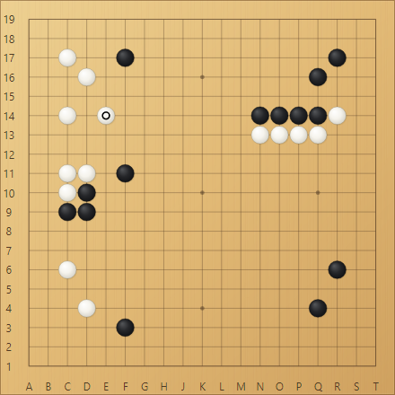
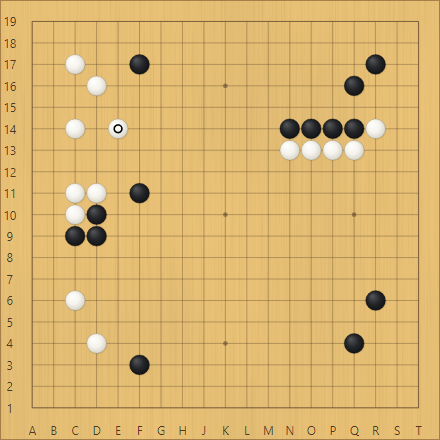
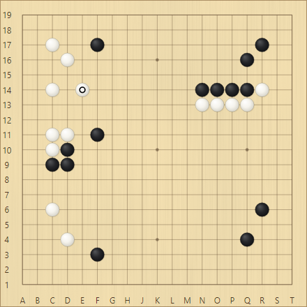
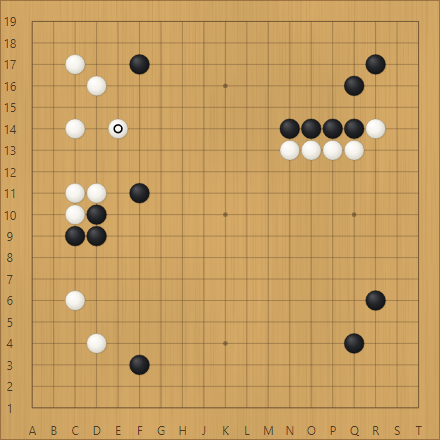
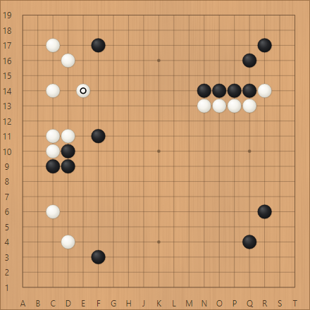
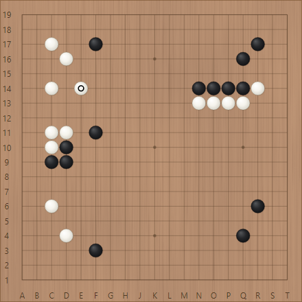
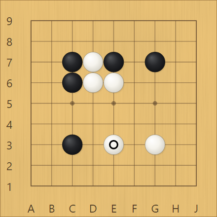
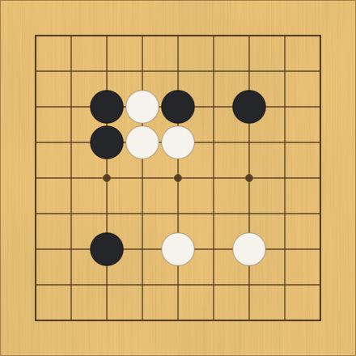

# Introducing KGS Nova

KGS Nova is a modern desktop client for Windows, macOS, and Linux.

With support from the American Go Foundation (AGF), Nova will
become KGS's new official client. The goal is to do everything the legacy
client can do, and more, while preparing KGS for future features such as
Fischer time.

[Download KGS Nova](https://github.com/amywarble/hoshi-hub/releases)
· [Getting started](https://amywarble.github.io/hoshi-hub/desktop/help/)

## Updates, built in

Nova checks for updates automatically. When a new version is available,
download it in the app and restart when you're ready.

## Highly customizable

Seven interface themes, six goban materials, and controls for the details:
stones, grid contrast, coordinates, and move markers. Theme and
goban choices are independent.

### Interface themes

Compare the same SGF editor in
[Dark Nova](../desktop/announcement/images/theme-dark-nova.png),
[Light Nova](../desktop/announcement/images/theme-light-nova.png),
[Dark Hoshi](../desktop/announcement/images/theme-dark-hoshi.png),
[Light Hoshi](../desktop/announcement/images/theme-light-hoshi.png),
[Dark Tsuki](../desktop/announcement/images/theme-dark-tsuki.png),
[Light Tsuki](../desktop/announcement/images/theme-light-tsuki.png),
and [Classic](../desktop/announcement/images/theme-classic.png).

### Goban styles

### Choose your stones and markings

## How Nova compares

Use your existing KGS account, rank, and game history.

| Feature | CGoban | Nova |
| --- | --- | --- |
| Rated and casual games | Yes | Yes |
| Automatch and custom games | Yes | Yes |
| Watch live games | Yes | Yes |
| Rooms and private chat | Yes | Yes |
| Teaching and shared reviews | Yes | Yes |
| View and edit SGF files | Yes | Yes |
| Local AI analysis | No | Yes* |
| Light and dark themes | No | Yes |
| Built-in app updates | No | Yes† |
| Simul and rengo | Yes | Not yet tested |

*Local AI analysis requires engine setup.

†In-app updating is available in supported release packages.

## Current status

Nova is fairly mature but still changing quickly, with published updates
about every one to two days. That pace will slow as the client stabilizes.

**Simul and rengo games have not yet been tested.** Both are on the testing
list.

## Feedback

Bug reports, missing features, and usability feedback are welcome.

[Report a problem](https://github.com/amywarble/hoshi-hub/issues/new?template=nova_bug_report.yml),
[suggest a feature](https://github.com/amywarble/hoshi-hub/issues/new?template=desktop_feature_request.md),
or email [hoshihatchery@gmail.com](mailto:hoshihatchery@gmail.com).
